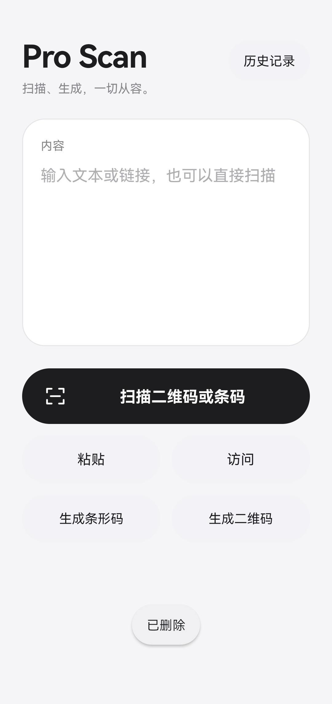
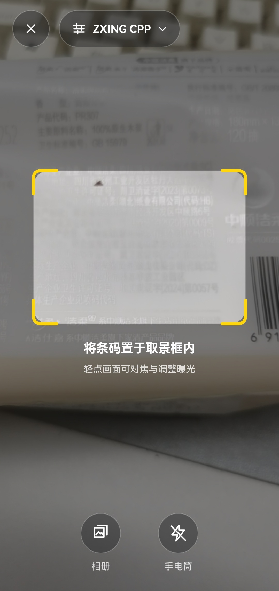
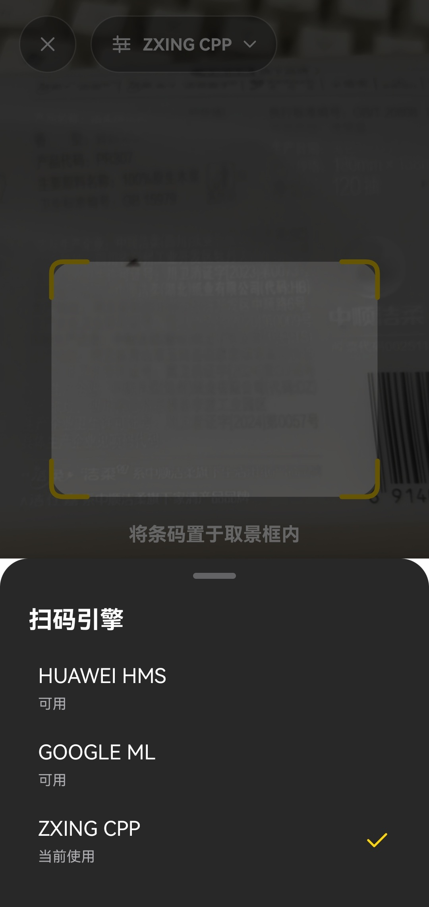
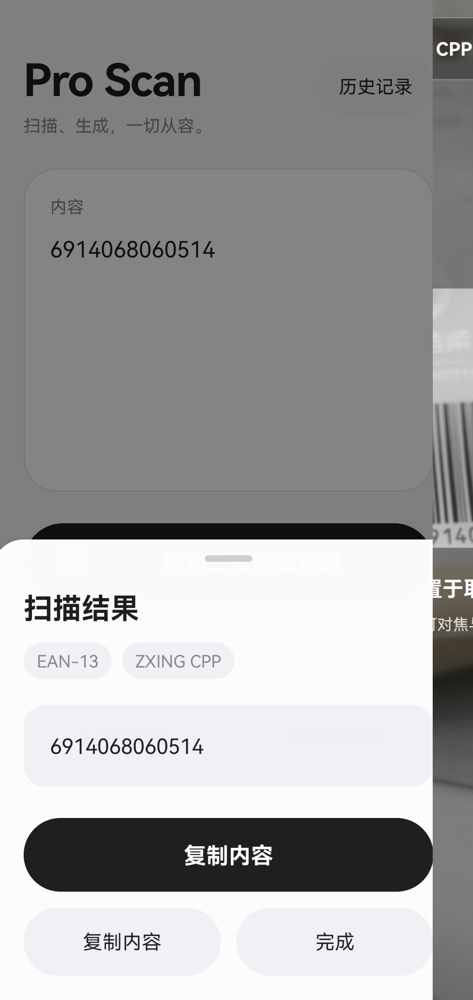
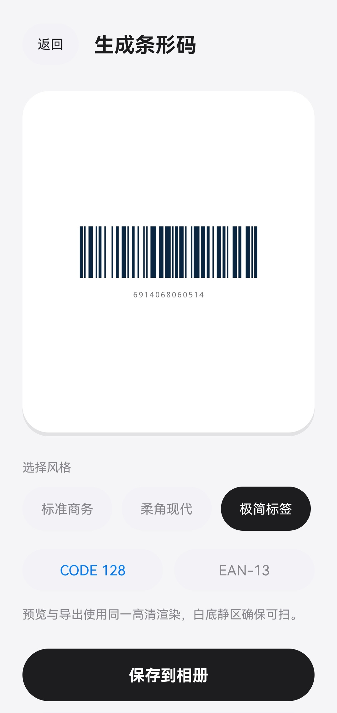
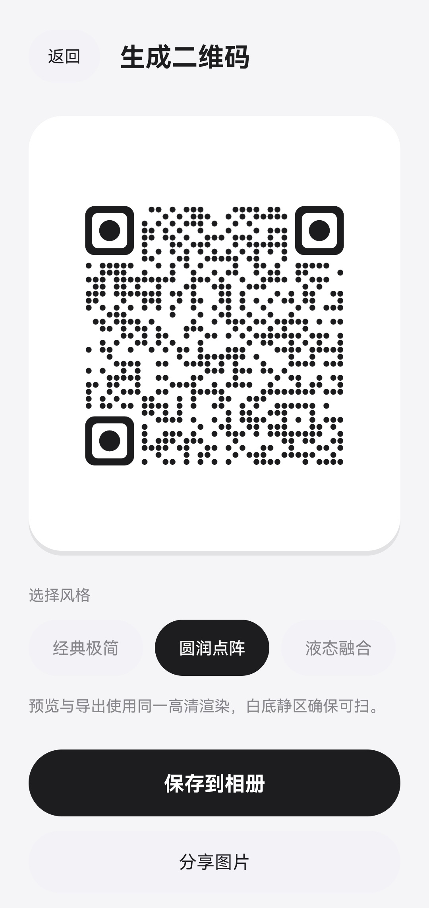

# Pro Scan

一个纯 Java 编写的 Android 扫码与码图生成工具，支持多引擎切换、曲面/反光条码识别、相册识图与风格化二维码生成。

[](https://developer.android.com)
[](https://www.java.com)
[](LICENSE)

---

## 目录

- [功能特性](#功能特性)
- [界面预览](#界面预览)
- [扫码引擎](#扫码引擎)
- [码图生成](#码图生成)
- [架构设计](#架构设计)
- [技术栈](#技术栈)
- [构建运行](#构建运行)
- [目录结构](#目录结构)
- [关键实现说明](#关键实现说明)
- [兼容性](#兼容性)
- [版本](#版本)
- [开源协议](#开源协议)

---

## 功能特性

### 扫码

- **多扫码引擎可插拔**：华为 HMS、Google ML Kit、ZXing-CPP，扫码页顶部胶囊一键切换。
- **只识别取景框内内容**：真正把屏幕取景框映射到相机传感器裁剪区域，画面中同时存在多个码时不会误取框外目标。
- **曲面/反光条码优化**：针对饮料罐等柱面金属包装，启用局部自适应二值化、旋转识别、反色识别、降采样低通与低命中行数策略。
- **两帧一致性确认**：同一结果连续命中 2 帧才上报，抑制曲面边缘 1D 条码的数字误读（如 6↔8）。
- **点击对焦与测光**：轻点画面触发 AF + AE，可压低金属反光区域的曝光，3 秒后自动恢复连续对焦。
- **手电筒**：按设备能力显示，状态与 CameraX `TorchState` 实时同步。
- **相册识图**：使用系统 Photo Picker，无需存储权限，支持 EXIF 方向校正。

### 结果与历史

- 扫码结果以 **24dp 圆角 BottomSheet** 展示，包含真实码制标签（由引擎实际返回，非文本猜测）、引擎标签、可选择文本，以及按内容类型变化的主操作（打开链接 / 复制内容）。
- 历史记录本地 SQLite 存储，支持点击回填、长按复制、单条删除与全部清空；数据库操作全部在后台线程执行。

### 码图生成

- **二维码 4 种风格**：经典极简、圆润点阵、液态融合、高级渐变。
- **一维条码 3 种风格**：标准商务、柔角现代、极简标签；支持 CODE 128 与 EAN-13。
- 高清导出：二维码 1024×1024、条码 1200×600，不透明 PNG，保存至 `Pictures/ProScan` 或系统分享。
- 全部风格均通过实际回读测试，保证风格化后依然可扫。

---

## 界面预览

| 主界面 | 扫码取景 |
|:---:|:---:|
|  |  |

| 引擎切换 | 扫码结果 |
|:---:|:---:|
|  |  |

| 生成条形码 | 生成二维码 |
|:---:|:---:|
|  |  |

---

## 扫码引擎

项目通过 `BarcodeScanner` 接口与 `BarcodeScannerFactory` 工厂实现可插拔引擎，均为纯 Java 实现，无 Kotlin / Compose 依赖。

| 引擎 | 实现 | 相机实时帧 | 相册 Bitmap | 完全离线 | 码制覆盖 |
|---|---|:---:|:---:|:---:|---|
| **GOOGLE ML** | ML Kit Barcode Scanning 17.3.0（模型打包，无需 GMS） | ✅ | ✅ | ✅ | 13 种常用码制 |
| **HUAWEI HMS** | HMS Core Scan Kit **scanplus** 2.12.0.300 | ✅ | ✅ | ❌ 需 HMS Core | 全码制 |
| **ZXING CPP** | zxing-cpp 2.3.0（JNI 原生） | ✅ | ✅ | ✅ | 全码制，含 MicroQR/RMQR |

### 引擎可用性

- 默认引擎为 **GOOGLE ML**；无有效偏好或所选引擎不可用时自动回落到它。
- **HUAWEI HMS** 通过官方 `HuaweiApiAvailability.isHuaweiMobileServicesAvailable()` 检测 HMS Core 实际服务状态，**不限设备品牌**；未安装、被禁用、版本不兼容或需更新时自动隐藏入口，不新增任何运行时权限。
- **ZXING CPP** 为纯本地实现，始终可用。
- 上次选择的引擎写入 `SharedPreferences`，主界面与扫码页共用同一份偏好，扫码页切换后返回主界面也不会出现显示与实际不一致。

### 曲面/反光条码调优

不同引擎采用了针对性的参数与策略：

- **ZXing-CPP**：`LOCAL_AVERAGE` 局部自适应二值化、`tryHarder` / `tryRotate` / `tryInvert` / `tryDownscale`、`downscaleFactor=2`、`minLineCount=1`。
- **HMS**：优先 NV21 字节流直读；远程解码链路异常时自动回退到 Bitmap 静态解码保底。相册识别单独走 Bitmap 路径。
- **ML Kit**：原生 YUV 管线，配合取景框坐标筛选；不在 Java 层做额外缩放或压缩，避免损失识别细节。

---

## 码图生成

编码与渲染完全解耦：`zxing-core` 只负责生成原始矩阵，视觉风格由原生 `Canvas` 绘制。

### 二维码

- `Encoder.encode()` 获取 `ByteMatrix`，默认纠错等级 **M**，静区不少于 4 个模块。
- **三个 7×7 定位眼独立绘制**，与数据模块严格分离，保证风格化后依然标准可扫。
- 风格：
  - **经典极简**：深炭灰直角模块，高对比度。
  - **圆润点阵**：数据点为模块宽度约 84% 的圆点，定位眼为大圆角外框 + 圆润内芯。
  - **液态融合**：按上下左右四邻域状态连接模块，仅在孤立外露角做圆角收口，不改变模块拓扑。
  - **高级渐变**：在点阵形态上叠加 `#0A2540 → #007AFF` 对角线性渐变。

### 一维条码

- `MultiFormatWriter` 获取 `BitMatrix`，条纹宽度严格保持比例，不压缩、不插值。
- 白底圆角卡片、充足静区、等宽字体明文居中（EAN-13 自动按 `6+6` 分组显示）。
- 风格：标准商务（纯黑锐利）、柔角现代（条纹上下端点微圆角）、极简标签（深海蓝 + 小字，比例更扁）。

### 输入校验

统一由 `BarcodeInputValidator` 处理，主界面、格式切换、风格切换与生成页使用同一套规则与中文提示：

- **CODE 128**：可打印 ASCII（数字、英文、空格、常见标点），最多 **32 个字符**；中文、全角字符、换行会给出明确中文原因。
- **EAN-13**：仅允许 12 或 13 位数字；13 位时主动校验校验位，不自动篡改用户输入。
- **超长内容**：在生成前拦截并提示改用二维码，避免输出过密而无法扫描的条码。

---

## 架构设计

```
io.github.letsopen.proscan
├── MainActivity                 主界面：输入、扫码入口、粘贴/访问、码图生成入口
├── HistoryActivity              历史记录页
├── adapter/HistoryAdapter       历史列表适配器
├── db/                          SQLite 持久层（单例 + 后台线程）
├── view/ViewfinderView          自绘取景蒙版与琥珀黄四角
├── scanner/
│   ├── BarcodeScanner           扫码引擎接口
│   ├── BarcodeScannerFactory    引擎创建、可用性过滤与降级
│   ├── ScanResult / ScanCallbackHolder
│   ├── decoder/                 FrameDecoder 接口与 ZXing-CPP 解码器
│   └── impl/                    三个引擎实现 + UnifiedScanActivity（统一取景与解码页）
└── generator/
    ├── CodeMatrixEncoder        矩阵编码（QR / 1D）
    ├── StyledQrRenderer         二维码 Canvas 渲染
    ├── StyledBarcodeRenderer    条码卡片渲染
    ├── BarcodeInputValidator    统一输入规则与中文提示
    ├── CodeImageExporter        MediaStore 保存 / FileProvider 分享
    └── CodeGeneratorActivity    生成页：预览、风格切换、导出
```

### 扫码数据流

```
CameraX ImageAnalysis ──► UnifiedScanActivity
    ├─ 取景框 ──► 屏幕坐标 → 传感器坐标映射（含旋转与中央裁剪）
    ├─ ML Kit   → InputImage(YUV) → 角点筛选
    ├─ HMS      → NV21 裁剪 → MLFrame → 失败回退 Bitmap
    └─ ZXing-CPP→ ImageProxy.cropRect → JNI 直读
                         │
              两帧一致性确认 → Activity Result → BottomSheet + 历史记录
```

---

## 技术栈

- **语言**：Java 11（无 Kotlin、无 Jetpack Compose）
- **UI**：原生 XML View + AndroidX + Material Components，自定义 Drawable / Canvas
- **相机**：CameraX（预览与分析均锁定 1280×720）
- **扫码**：ML Kit、HMS Scan Kit、ZXing-CPP
- **编码**：zxing-core（仅生成）
- **测试**：JUnit4 + Robolectric（真实 Canvas 渲染 + 回读校验）

---

## 构建运行

### 环境

- Android SDK Platform **34**
- JDK **11** 及以上
- Gradle Wrapper 8.13（随仓库提供）

### 配置 SDK 路径

在项目根目录 `local.properties` 中指定本机 SDK：

```properties
sdk.dir=/path/to/Android/Sdk
```

### 打包

Debug：

```bash
./gradlew assembleDebug
```

Release（签名信息通过环境变量或 Gradle 属性传入，避免密码入库）：

```bash
./gradlew assembleRelease \
  -PPROSCAN_STORE_FILE=key/default \
  -PPROSCAN_STORE_PASSWORD=你的store密码 \
  -PPROSCAN_KEY_ALIAS=你的alias \
  -PPROSCAN_KEY_PASSWORD=你的key密码
```

也可以把同样的键写入 `~/.gradle/gradle.properties`，之后直接 `./gradlew assembleRelease`。

产物位置：

- Debug：`app/build/outputs/apk/debug/app-debug.apk`
- Release：`app/build/outputs/apk/release/app-release.apk`

### 测试

```bash
./gradlew testDebugUnitTest
```

包含二维码 4 种风格、条码 3 种风格的回读校验，以及条码输入边界测试（中文、换行、校验位、超长内容、最大允许长度）。

---

## 目录结构

```
ProScan/
├── app/
│   ├── build.gradle
│   ├── proguard-rules.pro
│   └── src/
│       ├── main/
│       │   ├── AndroidManifest.xml
│       │   ├── java/io/github/letsopen/proscan/
│       │   └── res/            layout / drawable / values / xml
│       └── test/               渲染与校验单元测试
├── gradle/                     Wrapper
├── image/                      README 截图
├── key/                        签名密钥（本机使用，勿提交密码）
├── SCANNER_ARCHITECTURE.md     扫码引擎架构详解
├── COMPATIBILITY_ASSESSMENT.md 兼容性评估
└── README.md
```

---

## 关键实现说明

1. **取景框即采样区**：早期版本取景框仅为视觉提示，三个引擎实际解码整帧；现已建立屏幕 → 预览 → 传感器坐标映射，处理 `FILL_CENTER` 中央裁剪与 0/90/180/270 度旋转，并对 YUV 偶数对齐。4% 边缘余量只用于防止贴边截断。
2. **统一解码入口**：三个引擎共用 `UnifiedScanActivity`，通过 `ScanCallbackHolder` 传递回调；切换引擎时用 generation 计数丢弃旧引擎的迟到帧，避免串结果。
3. **内存与生命周期**：解码器、相机、手电筒、Bitmap 均在页面销毁时释放；后台线程只持有不依赖 Activity 的对象；扫码页退出清理静态回调。
4. **UI 安全区**：Edge-to-Edge 全屏，全部顶部/底部控件通过 `WindowInsets` 动态避让状态栏、导航栏与刘海。
5. **构建无警告**：已迁移弃用的 Manifest `package`、BuildConfig 全局开关、`startActivityForResult`、`onBackPressed` 与旧振动 API；Gradle 仓库赋值语法也已更新。

---

## 兼容性

- **minSdk**：30（Android 11）
- **targetSdk / compileSdk**：34（Android 14）
- **ABI**：`arm64-v8a`、`armeabi-v7a`
- 华为 HMS 在非华为设备上只要安装兼容且可用的 HMS Core 也可使用；无需华为账号。

更多细节见 [COMPATIBILITY_ASSESSMENT.md](COMPATIBILITY_ASSESSMENT.md) 与 [SCANNER_ARCHITECTURE.md](SCANNER_ARCHITECTURE.md)。

---

## 版本

| 项目 | 值 |
|---|---|
| versionName | **3.1** |
| versionCode | **37** |
| applicationId | `io.github.letsopen.proscan` |

> 维护约定：每次完成需求后 `versionCode` 递增；`versionName` 仅在明确指定时修改。

---

## 开源协议

本项目基于 [MIT License](LICENSE) 开源。

Copyright (c) 2025 letsopen
